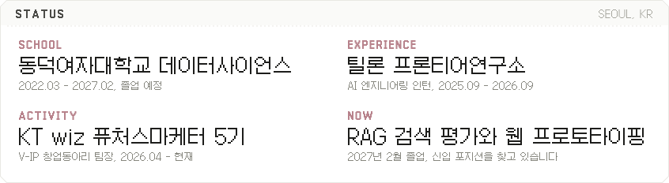
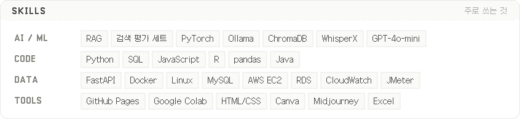

  

  <a href="https://yeninni.github.io/portfolioyelin/">포트폴리오</a> &nbsp;|&nbsp;
  <a href="mailto:shinrora@naver.com">shinrora@naver.com</a> &nbsp;|&nbsp;
  <a href="https://github.com/yeninni">github.com/yeninni</a>

  

## 소개

동덕여자대학교 데이터사이언스 전공이고 2027년 2월에 졸업합니다. 틸론 프론티어연구소에서 1년 동안 AI 엔지니어링 인턴으로 일했습니다.

강의자료 챗봇을 만들 때 검색과 생성을 같이 다뤘습니다. 답이 틀렸을 때 검색이 문제인지 생성이 문제인지 가려내려고 한국어와 일본어 50문항 평가 세트를 만들었고, 고칠 때마다 같은 질문으로 다시 확인했습니다. 문서를 요약하고 구간을 뽑는 파이프라인, 이중화 환경에서 멈추던 프로비저닝 장애 분석도 했습니다.

공공데이터로 바로 열리는 작은 웹 서비스를 만드는 것도 좋아합니다. 지금은 데이터와 AI 쪽 신입 포지션을 찾고 있습니다.

*Data Science at Dongduk Women's University (Feb 2027). One year as an AI engineering intern at Tilon, building RAG retrieval, evaluation sets, and web prototypes.*

## Projects

| 프로젝트 | 내용 | 링크 |
| --- | --- | --- |
| **WIZCOVERY** | KT wiz 팀스토어 굿즈 검색, 매장 재고와 품절 대안, 픽업 흐름 프로토타입 | [사이트](https://yeninni.github.io/wizcovery/) [코드](https://github.com/yeninni/wizcovery) |
| **YELIN.zip** | 픽셀 스타일 개인 포트폴리오, 한국어와 영어 | [사이트](https://yeninni.github.io/portfolioyelin/) |
| **짐, 내게 와** | 전국 공영 물품보관함 347곳의 위치와 크기별 남은 칸 | [사이트](https://yeninni.github.io/korea-data-/) [코드](https://github.com/yeninni/korea-data-) |
| **Miroro** | 40단계 브라우저 미로 게임, 스테이지 랜덤 생성 | [사이트](https://yeninni.github.io/miroro/) [코드](https://github.com/yeninni/miroro) |
| **Karby** | 수달 캐릭터 점프 게임, Supabase 리더보드 | [사이트](https://yeninni.github.io/game_karby/) [코드](https://github.com/yeninni/game_karby) |
| **김밥 MBTI** | 12문항 16유형 성격 테스트, 2026 김천김밥축제용 | [사이트](https://yeninni.github.io/kimbab/gimbap_mbti.html) [코드](https://github.com/yeninni/kimbab) |
| **T-money Titi** | 자동 하차 알림과 펫을 묶은 앱 구조 제안서 | [코드](https://github.com/yeninni/tmoneygo) |
| **Jeonnam ECO Trip** | 전남 여행 일정 화면 UI 데모 | [사이트](https://yeninni.github.io/trip-/) [코드](https://github.com/yeninni/trip-) |
| **Incheon AirWatch** | 인천공항 실시간 주차 혼잡도 프로토타입 | [사이트](https://yeninni.github.io/airport-incheon-project/) [코드](https://github.com/yeninni/airport-incheon-project) |

## Tech

  

## 자격

- 데이터분석 준전문가 (ADsP), 2025.03
- OPIc IM2, 2026.09
- 한국사능력검정시험 2급

## Contact

- Email: [shinrora@naver.com](mailto:shinrora@naver.com)
- Portfolio: [yeninni.github.io/portfolioyelin](https://yeninni.github.io/portfolioyelin/)
- GitHub: [@yeninni](https://github.com/yeninni)
- Seoul, South Korea
