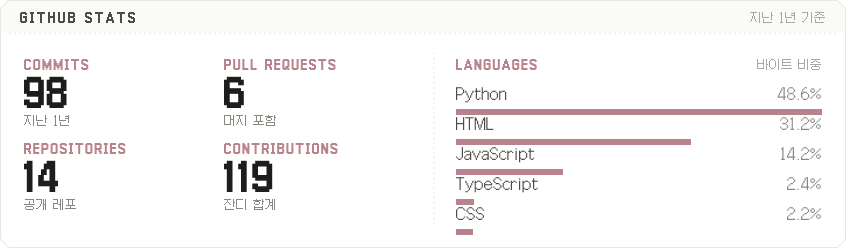

  

  <a href="mailto:shinrora@naver.com">shinrora@naver.com</a> &nbsp;|&nbsp;
  <a href="https://github.com/yeninni">github.com/yeninni</a>

## 소개

RAG 검색 평가, 데이터 파이프라인, 바로 열어 볼 수 있는 웹 프로토타입을 만듭니다. 지금은 데이터와 AI 쪽 신입 포지션을 찾고 있습니다.

*I build RAG retrieval, data pipelines, and web prototypes you can open right away.*

## Projects

| 프로젝트 | 내용 | 링크 |
| --- | --- | --- |
| **WIZCOVERY** | KT wiz 팀스토어 굿즈 검색, 매장 재고와 품절 대안, 픽업 흐름 프로토타입 | [사이트](https://yeninni.github.io/wizcovery/) [코드](https://github.com/yeninni/wizcovery) |
| **짐, 내게 와** | 전국 공영 물품보관함 347곳의 위치와 크기별 남은 칸 | [사이트](https://yeninni.github.io/korea-data-/) [코드](https://github.com/yeninni/korea-data-) |
| **Miroro** | 40단계 브라우저 미로 게임, 스테이지 랜덤 생성 | [사이트](https://yeninni.github.io/miroro/) [코드](https://github.com/yeninni/miroro) |
| **Karby** | 수달 캐릭터 점프 게임, Supabase 리더보드 | [사이트](https://yeninni.github.io/game_karby/) [코드](https://github.com/yeninni/game_karby) |
| **김밥 MBTI** | 12문항 16유형 성격 테스트, 2026 김천김밥축제용 | [사이트](https://yeninni.github.io/kimbab/gimbap_mbti.html) [코드](https://github.com/yeninni/kimbab) |
| **T-money Titi** | 자동 하차 알림과 펫을 묶은 앱 구조 제안서 | [코드](https://github.com/yeninni/tmoneygo) |
| **Jeonnam ECO Trip** | 전남 여행 일정 화면 UI 데모 | [사이트](https://yeninni.github.io/trip-/) [코드](https://github.com/yeninni/trip-) |
| **Incheon AirWatch** | 인천공항 실시간 주차 혼잡도 프로토타입 | [사이트](https://yeninni.github.io/airport-incheon-project/) [코드](https://github.com/yeninni/airport-incheon-project) |

## Tech

  

## GitHub Stats

  

## Contact

- Email: [shinrora@naver.com](mailto:shinrora@naver.com)
- GitHub: [@yeninni](https://github.com/yeninni)
- Seoul, South Korea
